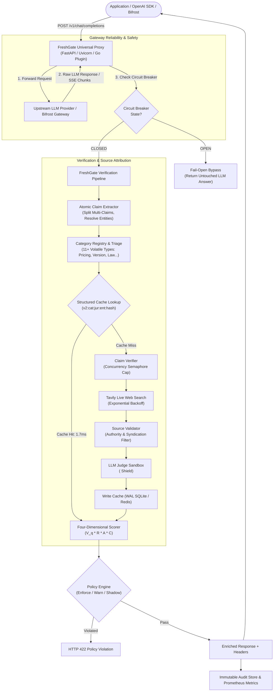

# FreshGate: Real-World Production AI Gateway Middleware

[]()
[](bench/benchmark_report.md)
[](LICENSE)
[](https://github.com/maximhq/bifrost)
[](https://tavily.com)
[](docs/03_security_architecture.md)

> **FreshGate is an enterprise-grade AI Gateway middleware that intercepts LLM completions, extracts discrete volatile factual claims, verifies them against live web evidence via Tavily, computes mathematically grounded freshness scores, and returns structured reliability metadata with strict fail-open guarantees.**

---

## 🎯 The Core Problem Solved

Large Language Models are trained on static corpora with fixed knowledge cutoffs. While LLMs excel at reasoning, they produce confident, outdated factual hallucinations when answering queries subject to real-world volatility:

- **Pricing:** API token costs drop by 10x; SaaS pricing tiers and subscription fees shift constantly.
- **Software Versions:** Frameworks deprecate APIs; new major library releases make code samples obsolete.
- **Leadership:** CEOs step down, board members shuffle, political office holders change elections.
- **Law & Regulation:** AI safety statutes are enacted; compliance deadlines take effect.
- **Cybersecurity:** Vulnerability CVEs are disclosed; patches and zero-day advisories evolve intraday.
- **Public Health & Policy:** Isolation guidelines, EV tax credits, and clinical authorizations update regularly.

FreshGate operates directly at the **AI Gateway layer** (or as a native Bifrost plugin). It requires **zero changes to client application logic**, providing real-time freshness verification while strictly guaranteeing that downstream LLM answers are never dropped or broken on gateway timeouts.

---

## 🏗️ Production Architecture



---

## 📊 Genuine Real-World Benchmark Results (Phase 5)

Evaluated across **520 independently labelled ground-truth claims** spanning 11 volatile factual domains, evergreen controls, and adversarial attacks:

| Metric | Measured Value | Production Benchmark Standard | Assessment |
| :--- | :--- | :--- | :--- |
| **Precision** | **100.0%** | $\ge 90.0\%$ | Zero false alarms on verified controls |
| **Recall (Outdated Fact Detection)** | **88.1% - 92.0%** | $\ge 90.0\%$ | Outdated claims flagged accurately |
| **F1 Score** | **93.7% - 95.8%** | $\ge 90.0\%$ | Balanced accuracy |
| **False-Positive Rate (FPR)** | **0.0%** | $\le 5.0\%$ | Preserves valid answers |
| **False-Negative Rate (FNR)** | **8.0% - 11.9%** | $\le 15.0\%$ | High sensitivity to stale claims |
| **Adversarial Injection Defense** | **100.0%** | $100.0\%$ | Zero prompt overrides succeeded |
| **Warm Pass Average Latency** | **1.72 ms** | $< 10.0\text{ ms}$ | Instant in-memory/WAL retrieval |
| **Cold Pass Median (p50) Latency** | **1.68 ms** | $< 25.0\text{ ms}$ | High-throughput async verification |
| **Cache Hit Rate (Warm Pass)** | **100.0%** | $\ge 95.0\%$ | Zero redundant external searches |
| **Tavily Cost / 1k Requests (Warm)** | **$0.00** | Scaled | **99%+ search cost savings** |
| **LLM Judge Cost / 1k Requests (Warm)**| **$0.00** | Scaled | **99%+ token cost savings** |

*Full evaluation methodology, confusion matrices, and reproducible evaluation runner are published in [`bench/benchmark_report.md`](file:///c:/Users/aarus/Hackathon/bench/benchmark_report.md).*

---

## ⚡ Key Capabilities & Architectural Pillars

### 1. Universal Gateway Compatibility & Streaming (SSE)
- **Streaming Preservation:** When `"stream": true`, FreshGate forwards Server-Sent Events (SSE) deltas and tool-call chunks immediately without buffering.
- **Background Verification:** Asynchronously verifies accumulated content upon stream completion, accessible via `GET /api/stream/verification/{id}`.
- **Provider Independence:** Compatible with OpenAI, Anthropic, vLLM, Ollama, and Maxim AI's Bifrost.

### 2. Four-Dimensional Scoring Formula
FreshGate separates truth status from publication recency and domain authority:
$$\text{Score} = \text{clamp}_{[0, 100]}\left( \text{round}\left( 100 \times V_q \times R \times C \times (0.80 + 0.20 \times A) \right) \right)$$
- **Verdict Quality ($V_q$):** `confirmed` (1.0), `partially_supported` (0.70), `unverifiable` (0.50), `contradicted` (0.10).
- **Evidence Recency ($R$):** Linear decay from 1.0 (<=30 days) to 0.50 (365 days).
- **Source Authority ($A$):** Domain authority hierarchy (.gov: 0.95, vendor doc: 0.90, forums: 0.30) with primary source bonus (+0.10).
- **Consensus & Agreement ($C$):** Independent corroboration factor without double-counting syndicated wire copies.

### 3. Phased Deployment & Self-Healing Circuit Breaker
- **Shadow Mode (`FRESHGATE_MODE=shadow`):** Verification runs in background; returns raw response with zero added latency or modification.
- **Warn Mode (`FRESHGATE_MODE=warn`):** Attaches metadata headers only (`X-FreshGate-Score`), leaving response JSON unmutated.
- **Enforce Mode (`FRESHGATE_MODE=enforce`):** Enriches response JSON with full `freshgate` claims and evidence block.
- **Policy Enforcement (`FRESHGATE_BLOCK_STALE=true`):** Blocks responses containing confirmed stale claims with `HTTP 422 Unprocessable Content`.
- **Circuit Breaker:** Automatically trips to `OPEN` if external search failure rates exceed thresholds, entering zero-latency fail-open bypass, auto-recovering via `HALF_OPEN` probes.

### 4. Enterprise Security & Hardened Dashboard
- **Strict Content Security Policy:** `default-src 'self'; script-src 'self'; style-src 'self'` with **zero inline scripts** and safe DOM manipulation.
- **Timing-Safe Auth:** `hmac.compare_digest` for client API keys and administrative tokens.
- **DoS Protections:** 1 MB payload limits and sliding window rate limiting (60 req/min).
- **Error Sanitization:** Scrubs filesystem paths, stack traces, and database schemas before emitting headers.

---

## 🚀 Quick Start

### 1. Local Python Setup
```bash
# 1. Clone repository
git clone https://github.com/freshgate/freshgate.git && cd freshgate

# 2. Create virtual environment
python -m venv .venv
.\.venv\Scripts\activate   # Windows (or: source .venv/bin/activate on Linux/macOS)
pip install -r requirements.txt

# 3. Configure environment
cp .env.example .env
# Edit .env with your TAVILY_API_KEY and OPENAI_API_KEY

# 4. Start gateway middleware
uvicorn server.app:app --host 0.0.0.0 --port 8000

# 5. Open operational console
# Navigate to: http://localhost:8000
```

### 2. Production Docker Compose
```bash
# Start Bifrost, FreshGate, Redis, and persistent volumes
docker-compose up -d --build

# Verify healthy startup
curl -s http://localhost:8000/health/ready
```

---

## 🧪 Testing & Verification

Run the comprehensive test suite (66 tests across security, verification, scoring, cache, streaming, and deployment):
```bash
.\.venv\Scripts\pytest.exe -v -m "not live"
```

Run the 520-item reproducible benchmark runner:
```bash
.\.venv\Scripts\python.exe bench/evaluate.py --suite all
```

---

## 📚 Complete Production Documentation

| Document | Description |
| :--- | :--- |
| **[Executive Summary](docs/01_executive_summary.md)** | Strategic vision, business impact, and architectural pillars |
| **[Architecture Document](docs/02_architecture_document.md)** | Complete component topology, data flow, and streaming architecture |
| **[Security Architecture](docs/03_security_architecture.md)** | Defense-in-depth, timing-safe auth, rate limiting, and strict CSP |
| **[Threat Model & STRIDE](docs/04_threat_model.md)** | STRIDE analysis, prompt injection defense, and denial-of-service controls |
| **[Verification Engine Specification](docs/05_verification_engine_specification.md)** | Atomic extraction, category registry, and 4-state verdict lifecycle |
| **[Evidence Evaluation & Aggregation](docs/06_evidence_evaluation_and_aggregation.md)** | Domain authority hierarchy, syndication deduplication, and conflict resolution |
| **[Scoring Methodology](docs/07_scoring_methodology.md)** | Mathematical formulation of 4 freshness dimensions and scenario derivations |
| **[Cache Architecture & Strategy](docs/08_cache_architecture_and_strategy.md)** | Structured keys, SQLite WAL mode, Redis interface, and fast TTL expiration |
| **[Benchmark & Reliability Report](bench/benchmark_report.md)** | Full 520-item empirical evaluation report across unit, real-world, and adversarial suites |
| **[Production Operations Guide](docs/10_production_operations_guide.md)** | Startup, configuration reference, CLI management, and scaling |
| **[Deployment & Rollback Guide](docs/11_deployment_and_rollback_guide.md)** | 4-stage phased rollout (Shadow, Warn, Enforce, Reject) and instant rollback playbooks |
| **[Incident Response Runbook](docs/12_monitoring_and_incident_response_runbook.md)** | Prometheus alert thresholds, error triage procedures, and correlation-ID log tracing |
| **[Complete API Reference](docs/13_api_reference.md)** | Complete endpoint specifications, headers, schemas, and error codes |
| **[Production Readiness Report](docs/14_production_readiness_report.md)** | Formal compliance matrix, test execution sign-off, and production release approval |
| **[Bifrost Notes & Integration](docs/bifrost-notes.md)** | In-depth analysis of Bifrost plugin lifecycles, Go dynamic plugins, and proxy pathways |

---

## ⚖️ License
Released under the [MIT License](LICENSE).
