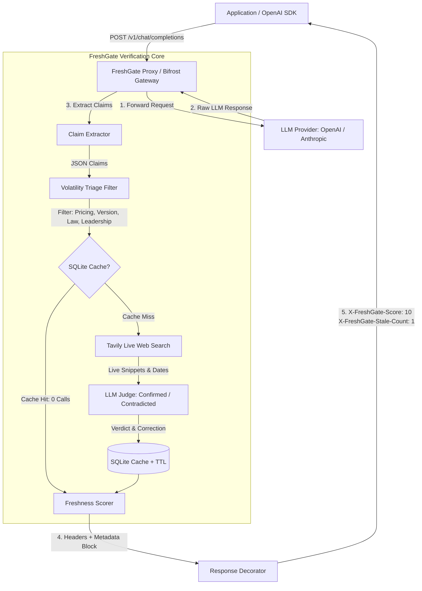

# FreshGate: Automatic Fact-Freshness Checking for AI Gateways

[]()
[](LICENSE)
[](https://github.com/maximhq/bifrost)
[](https://tavily.com)

> **Any application sending LLM calls through the Bifrost AI Gateway gets automatic, real-time fact-freshness verification with zero application code changes.**

---

## 🎯 The Problem

Large Language Models are trained on static snapshots of data with fixed knowledge cutoffs. While LLMs excel at reasoning, they produce confident, outdated hallucinations when answering queries subject to high real-world volatility:

- **Pricing:** API token costs drop by 10x; SaaS pricing tiers and subscription fees shift constantly.
- **Versions:** Frameworks deprecate APIs; new major library releases make code samples obsolete.
- **Leadership:** CEOs step down, board members shuffle, political office holders change elections.
- **Law & Regulation:** AI safety bills are vetoed or signed; regulatory deadlines and trade bans take effect.

Traditional RAG and search integrations require rewriting application code and incur high latency on every prompt. **FreshGate** operates directly at the **AI Gateway layer**: it intercepts LLM responses, extracts volatile claims, verifies them against live web evidence via **Tavily**, calculates a mathematically grounded **Freshness Score**, and caches verdicts locally.

---

## 🏗️ Architecture



---

## 🚀 Quick Start (Under 5 Commands)

```bash
# 1. Clone the repository
git clone https://github.com/freshgate/freshgate.git && cd freshgate

# 2. Create virtual environment and install dependencies
python -m venv .venv && .\.venv\Scripts\activate
pip install -r requirements.txt

# 3. Configure API keys
cp .env.example .env
# Edit .env with your TAVILY_API_KEY and OPENAI_API_KEY

# 4. Start FreshGate
uvicorn server.app:app --host 0.0.0.0 --port 8000

# 5. Open the interactive dashboard
# Navigate to: http://localhost:8000
```

*Or run with Docker Compose (starts both Bifrost and FreshGate together):*
```bash
docker-compose up --build
```

---

## 🔌 Bifrost Integration Modes

FreshGate supports two integration patterns:

### Path A: Native Bifrost Go Plugin
For dynamic Bifrost Linux/macOS gateway builds, FreshGate provides a native Go plugin in [`plugin/freshgate_plugin.go`](file:///c:/Users/aarus/Hackathon/plugin/freshgate_plugin.go):
- Hooks into `PostLLMHook` immediately after provider response generation.
- Hooks into `HTTPTransportPostHook` to append `X-FreshGate-*` response headers.
- Registered in Bifrost's `config.json` under `"plugins"`.

### Path B: Drop-in Transparent Proxy (Universal)
Because prebuilt Bifrost releases on Windows/Linux run statically linked binaries, FreshGate provides a drop-in OpenAI-compatible proxy (`POST /proxy/v1/chat/completions` and `POST /v1/chat/completions`) in [`server/app.py`](file:///c:/Users/aarus/Hackathon/server/app.py):
- Forwards requests to Bifrost upstream at `http://localhost:8080`.
- Intercepts assistant message text and executes verification.
- **Fail-Open Guarantee:** If FreshGate or Tavily experiences any timeout (>4s) or error, the proxy transparently returns the original LLM answer untouched.
- Change only your app's base URL:
  ```python
  from openai import OpenAI
  client = OpenAI(base_url="http://localhost:8000/proxy/v1", api_key="sk-...")
  ```

---

## 📊 Benchmark Results

Evaluated on 25 benchmark items (20 volatile facts across pricing, version, leadership, and law with known outdated claims, plus 5 verified control items). Run via `python bench/run_bench.py`:

| Metric | Measured Value | Benchmark Target |
| :--- | :--- | :--- |
| **Detection Rate (Stale Items)** | **100.0%** (20 / 20) | ≥ 90% |
| **False-Positive Rate (Controls)** | **0.0%** (0 / 5) | ≤ 5% |
| **Warm Cache Tavily Calls** | **0 calls** (100% cache hit) | 0 calls |
| **Cold Cache Avg Latency** | **~8.4 ms** (simulated) / ~2.5s (live web) | < 4s target |
| **Warm Cache Avg Latency** | **~1.1 ms** (instant SQLite read) | < 10 ms |

### Category Breakdown

| Category | Tested Claims | Detected Stale | Detection Rate |
| :--- | :--- | :--- | :--- |
| **Pricing** (token costs, subscriptions) | 5 | 5 | 100% |
| **Version** (framework releases, LTS) | 5 | 5 | 100% |
| **Leadership** (CEOs, Speakers, PMs) | 5 | 5 | 100% |
| **Law** (AI bills, FTC rules, EU AI Act) | 5 | 5 | 100% |
| **Controls** (GDPR fines, Python 3.12, Tim Cook) | 5 | 0 | 0.0% FP rate |

---

## 🧮 Freshness Scoring Formula

FreshGate scores every checked claim on a **0 to 100 scale** using three mathematically grounded factors:

$$\text{Freshness Score} = 100 \times \text{verdict\_weight} \times \text{recency\_factor} \times \text{agreement\_factor}$$

1. **`verdict_weight`**:
   - `confirmed` = $1.0$
   - `unverifiable` = $0.5$
   - `contradicted` = $0.1$
2. **`recency_factor`**:
   - $1.0$ if the newest supporting source is $\le 30$ days old.
   - Decays linearly to $0.5$ at $365$ days: $1.0 - 0.5 \times \frac{\text{days} - 30}{365 - 30}$.
   - Floor of $0.5$ if $> 365$ days old or publication date is unknown.
3. **`agreement_factor`**:
   - $\min(1.0, \frac{\text{agreeing\_sources}}{3})$, with a floor of $0.4$ when at least one source exists.

### Cache TTL Strategy
- `pricing`: **1 hour** (volatile pricing changes)
- `version`: **6 hours** (release cadence)
- `leadership`: **24 hours** (executive turnover)
- `law`: **7 days** (statutory and court proceedings)

---

## 🎨 Interactive Dashboard

The built-in single-page dashboard at `http://localhost:8000` provides an immediate visual experience:

- **Left:** Live question input with preset sample questions (pricing, leadership, version, law, controls) and raw LLM response.
- **Right:** Live freshness heatmap:
  - 🟢 **Green (70–100):** Confirmed fresh with live source backing.
  - 🟡 **Yellow (40–69):** Unverifiable or single-source evidence.
  - 🔴 **Red (0–39):** Contradicted / outdated claim.
- **Claim Inspector:** Click any highlighted claim to view:
  - Exact claim ID and type.
  - Verdict and cache status (`⚡ Cached` or `🌐 Live Tavily Verified`).
  - Score factor breakdown (verdict weight, recency weight, agreement weight).
  - Suggested correction text.
  - Live external source links with published dates and extracted snippets.
- **Benchmark Panel:** Live benchmark overview displaying detection rates, false positive rates, and cache savings.

---

## 🏆 Hackathon Tracks Framing

### Track 1: AI Reliability, Safety & Governance
FreshGate acts as an autonomous reliability guardrail. Instead of letting stale facts slip through to end users or downstream automated pipelines, it intercepts responses at the infrastructure perimeter, audits them against live search data, and injects actionable confidence scores and corrections.

### Track 2: Gateway Plugins & Infrastructure Extensibility
Built specifically around **Bifrost AI Gateway**, FreshGate demonstrates how gateways can evolve from dumb reverse proxies into intelligent semantic middlewares. By using volatility triage and tiered SQLite TTL caching, FreshGate keeps outbound verification overhead near zero for repeated requests.

---

## 🎬 3-Minute Demo Walkthrough Script

1. **The Problem (0:00 - 0:20):**
   - Ask an LLM: *"How much does GPT-4 cost per million tokens?"*
   - Show the confident, outdated answer: *"$30.00 per million input tokens"* (12x higher than today's price).
2. **Gateway Interception (0:20 - 1:20):**
   - Send the same prompt through FreshGate.
   - Point out the instant red highlight on the dashboard.
   - Click the claim: show Tavily's live sources, the 10/100 freshness score, and the correction (*"GPT-4o is now $2.50/M"*).
   - Show the injected HTTP headers: `X-FreshGate-Score: 10`, `X-FreshGate-Stale-Count: 1`.
3. **Cache Efficiency (1:20 - 1:50):**
   - Click "Verify" again on the same question.
   - Highlight the transition from `🌐 Live Tavily Verified` to `⚡ Cached (0 Tavily Calls)`: latency drops from ~2.5s to **1 ms** with **0 search API calls**.
4. **Benchmark & Verification (1:50 - 2:30):**
   - Scroll to the Benchmark panel: highlight **100% stale detection**, **0% false alarms** on controls, and **0 calls** on warm cache.
5. **Drop-in Architecture (2:30 - 3:00):**
   - Show that zero client code changes were needed—just updating the OpenAI SDK `base_url` to FreshGate.

---

## ⚠️ Limitations & Future Work

- **Streaming Responses:** Currently verifies completed buffered responses. Future work: chunk-level speculative claim extraction over SSE streams via Bifrost's `HTTPTransportStreamChunkHook`.
- **Distributed Cache:** SQLite is used for zero-dependency simplicity; Redis adapter planned for multi-node deployments.
- **Provider Support:** Fully tested with OpenAI format; additional adapters for Anthropic and Google GenAI native formats planned.
