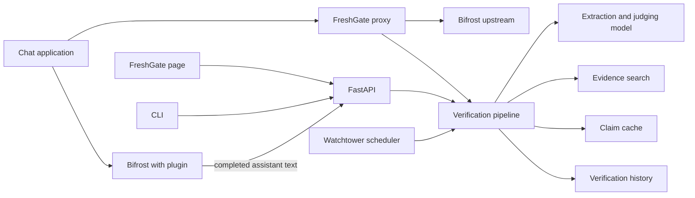

# System architecture

The React page, CLI, native Bifrost plugin and proxy all lead to the Python verification engine. The entry point determines whose credentials fund the check, where history is written and how the result reaches the caller.

## Request ownership

A signed-in dashboard request builds a pipeline from the owner's Profile and scopes its feature store to that owner. A direct client can supply provider credentials in request headers. The plugin sends assistant text to a dedicated service route authenticated with the integration key. The proxy forwards the chat request upstream and uses server credentials for verification.

Watchtower obtains the claim owner's provider settings when a check is due. A local deployment with SQLite accounts and features can resolve a claim through its sole account. MongoDB supports explicit owner scopes for a shared service.

## Process and storage boundaries

FastAPI serves the production frontend from the compiled dashboard bundle. Bifrost and FreshGate run in separate processes even when the Go plugin is loaded. The plugin's outbound HTTP timeout limits its wait for FreshGate. The proxy has separate time budgets for contacting Bifrost and verifying a completion.

Feature data, verification cache and audit records have different lifetimes. Policies and snapshots belong in the feature store. Redis or SQLite serves cache lookups. The audit ledger uses SQLite. Streaming result lookup and some operational counters live in the serving process, so a restart or a request reaching another worker can affect lookup. See [feature relationships](feature-architecture.md) and [cache design](08_cache_architecture_and_strategy.md).

Implementation entry points are the [FastAPI application](../server/app.py), [pipeline factory](../server/pipeline_factory.py) and [verification engine](../core/pipeline.py).
