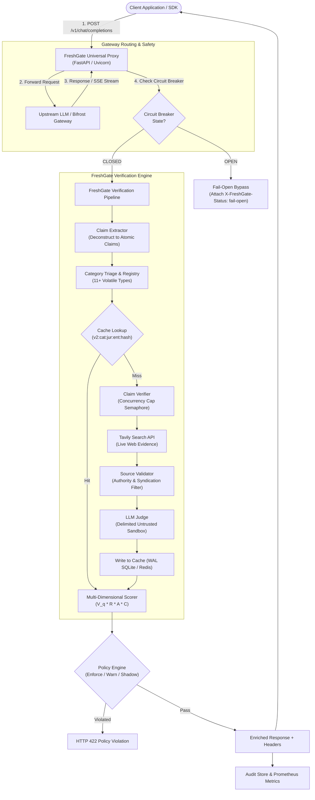

# FreshGate: Architecture Document

## 1. System Overview

FreshGate operates as a high-throughput, low-latency AI Gateway middleware designed to sit between client applications and LLM backends (such as OpenAI, Anthropic, or an orchestration proxy like Maxim AI's Bifrost).

---

## 2. Component Inventory & Responsibilities

### 2.1 Universal Proxy (`server/app.py`)
- Acts as a drop-in replacement for OpenAI `/v1/chat/completions`.
- Handles both non-streaming JSON responses and Server-Sent Events (SSE) streaming (`stream: true`).
- Enforces security middlewares: `CorrelationIdMiddleware`, `SecurityHeadersMiddleware`, `RequestBodySizeLimitMiddleware`, and `RateLimitMiddleware`.
- Implements fail-open timeout: if verification exceeds `FRESHGATE_TIMEOUT` (default: 4.0s) or fails, the raw LLM response is delivered untouched to the client with `X-FreshGate-Status: fail-open`.

### 2.2 Claim Extractor (`core/extractor.py`)
- Deconstructs complex LLM responses, tables, bullet points, and multi-claim sentences into atomic factual claims.
- Normalizes text, resolves coreferences, extracts named entities, numerical values, and temporal anchors.

### 2.3 Category Registry (`core/categories.py`)
- Extensible registry defining 11+ volatile domains (`pricing`, `version`, `law`, `leadership`, `product_availability`, `cybersecurity`, `financial`, `government_policy`, `public_health`, `scientific_findings`, `company_info`) and `other`.
- Configures domain-specific search strategies, cache TTLs, source authority weights, and confidence requirements.

### 2.4 Claim Verifier (`core/verifier.py`)
- Coordinates concurrent web searches via `TavilySearchClient` with backoff and retry.
- Wraps retrieved snippets in strict XML boundaries (`<untrusted_web_evidence>`) to defeat prompt injections.
- Employs an LLM judge to determine a 4-state verdict (`confirmed`, `contradicted`, `partially_supported`, `unverifiable`).

### 2.5 Source Validator (`core/sources.py`)
- Scores domain authority (e.g., `.gov`, primary software vendor vs low-authority forums).
- Distinguishes primary documentation from syndication or duplicate wire reporting.

### 2.6 Multi-Dimensional Scorer (`core/scorer.py`)
- Computes composite freshness scores (0 - 100) combining Verdict Quality, Evidence Recency, Source Authority, and Consensus Confidence.

### 2.7 Caching Layer (`core/cache.py`)
- Provides versioned, structured cache keys (`v2:<category>:<jurisdiction>:<entity>:<hash>`).
- Implements Write-Ahead Logging (WAL) and busy timeout in SQLite for local zero-config deployments.
- Provides `RedisClaimCache` for distributed multi-instance architectures.
- Assigns short TTL (300s) to unverifiable claims to allow prompt reverification.

### 2.8 Circuit Breaker (`core/circuit_breaker.py`)
- Monitors error and timeout rates. Trips to `OPEN` when consecutive failures exceed thresholds, auto-recovering via `HALF_OPEN` health probes.

### 2.9 Observability & Audit Store (`core/metrics.py`, `core/audit.py`)
- Exposes Prometheus operational metrics on `/metrics`.
- Persists immutable request audit records to SQLite. PostgreSQL audit persistence is not implemented yet.

### 2.10 Feature history and Replay (`core/persistence.py`, `core/history.py`, `core/replay.py`)
- Stores policy configuration, monitored claims, immutable per-claim verification snapshots, and Watchtower alerts in the separately configured feature database.
- Each checked volatile claim receives a `verification_id` and stable context-aware fingerprint. Snapshots preserve score dimensions, source evidence, policy, cache status, and verification duration.
- Replay reads snapshots and alerts to build chronological timelines and evidence comparisons; it does not mutate history.
- Watchtower leases due rows in SQLite so worker processes sharing the same database do not claim the same active job.

See [Feature architecture](feature-architecture.md) and [Verification Replay](verification-replay.md) for data flow and storage limits.

---

## 3. Streaming (SSE) Architecture

When a client sets `"stream": true`:
1. FreshGate connects to the upstream provider using `httpx.AsyncClient.stream`.
2. SSE chunks are forwarded immediately to the client without buffering, preserving all delta formatting and tool-call deltas (`data: {"choices": [{"delta": ...}]}`).
3. An in-memory delta accumulator concurrently collects the assistant's content stream up to a defensive ceiling (50,000 characters).
4. Upon encountering `data: [DONE]`, a non-blocking background verification task is spawned (`run_streaming_verification`).
5. Completed verification results are cached by completion ID and queryable via `GET /api/stream/verification/{id}`.
