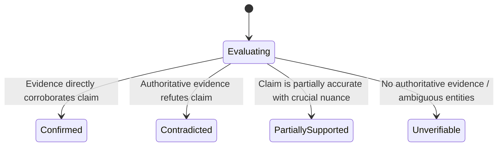

# FreshGate: Verification Engine Specification

## 1. Claim Extraction Architecture

The Claim Extraction subsystem (`core/extractor.py`) is responsible for decomposing unstructured assistant responses into normalized, discrete atomic factual claims.

### 1.1 Atomic Decomposition Requirements
- **Multi-Claim Splitting:** A sentence containing multiple factual statements (e.g. *"Python 3.12 is the latest release, and ChatGPT Plus costs $20/month"*) is split into discrete atomic objects.
- **Table & List Parsing:** Markdown tables and bulleted lists are deconstructed row-by-row into standalone assertions.
- **Entity Resolution:** Pronouns (*"he"*, *"it"*, *"they"*) are resolved to their explicit named entities so each claim is self-contained.
- **Entity & Numeric Extraction:** Specific entities (e.g., `["AWS", "S3"]`), numerical values (`"$0.023 per GB"`), and temporal anchors (`"October 2023"`) are structured as discrete metadata fields.

### 1.2 Normalization & Deduplication
To prevent duplicate verification queries for identical claims expressed with minor punctuation or whitespace variations:
```python
clean = text.lower().strip()
clean = re.sub(r"\s+", " ", clean)
clean = clean.translate(str.maketrans("", "", string.punctuation))
```
Claims sharing normalized representations within a single response are deduplicated.

---

## 2. Category Registry & Volatility Triage

The Category Registry (`core/categories.py`) provides an extensible framework for defining factual domains.

### 2.1 Registered Volatile Categories
| Category | Scope & Examples | Targeted Search Strategy | Default TTL |
| :--- | :--- | :--- | :--- |
| `pricing` | Subscription rates, token prices, cloud tiers | `"<entity> official pricing tier cost"` | 12 hours |
| `version` | Software releases, LTS support, deprecations | `"<entity> latest release version changelog"` | 24 hours |
| `law` | Statutes, court rulings, regulatory orders | `"<entity> regulation statute enacted legal text"` | 7 days |
| `leadership` | CEOs, board chairs, cabinet officials | `"<entity> current CEO leadership executive appointment"` | 48 hours |
| `product_availability` | General availability, waitlists, shutdowns | `"<entity> product release status availability discontinued"` | 24 hours |
| `cybersecurity` | CVE vulnerabilities, active exploits, patches | `"<entity> CVE security vulnerability advisory patch"` | 6 hours |
| `financial` | Benchmark interest rates, quarterly earnings | `"<entity> financial metrics rate earnings report"` | 12 hours |
| `government_policy` | Sanctions, clean energy subsidies, tax credits | `"<entity> government policy directive rule"` | 7 days |
| `public_health` | CDC/WHO isolation directives, vaccine guidance | `"<entity> official public health advisory guidance"` | 3 days |
| `scientific_findings` | Replications, breakthrough discoveries, models | `"<entity> scientific findings paper replication nature"` | 7 days |
| `company_info` | Mergers, acquisitions, headquarters relocations | `"<entity> acquisition merger company corporate announcement"` | 48 hours |
| `other` | Static evergreen facts (math, physics, syntax) | Filtered out during triage | N/A |

### 2.2 Volatility Triage (`core/triage.py`)
Claims classified as `other` (evergreen geography, classical history, mathematical truths) bypass web search and are immediately assigned a perfect freshness score (100) with zero outbound API queries. Only volatile categories proceed to search retrieval.

---

## 3. Four-State Verdict System

Every evaluated volatile claim is assigned exactly one of four distinct states:



1. **`confirmed`**: Authoritative evidence directly verifies that the claim is currently accurate. Score: **85 - 100**.
2. **`contradicted`**: Authoritative evidence refutes the assertion. A factual correction supported by evidence is attached. Score: **0 - 25**.
3. **`partially_supported`**: The statement contains accurate elements but omits critical qualification (e.g. tier restrictions or preconditions). Score: **60 - 75**.
4. **`unverifiable`**: Search results yielded no credible primary citations or entities are ambiguous. Assigned abbreviated TTL (300s). Score: **40 - 55**.
