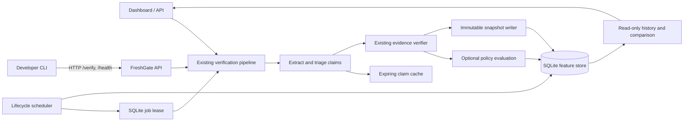

# Feature architecture

Policy Studio, Watchtower, and Replay share the SQLite feature store configured by `FRESHGATE_FEATURE_DB`. It is separate from the expiring claim cache and the existing whole-request audit store.

## Data boundaries

- `core/cache.py` remains a reusable expiring result cache; it is not historical storage.
- `core/persistence.py` owns versioned SQLite schemas for policies, monitored claims, snapshots, and alerts. Snapshots are append-only by SQLite triggers.
- `core/policies.py` validates policy configuration and evaluates evidence constraints. Policy selection is optional for direct verification.
- `core/watchtower.py` uses SQLite leases, bounded concurrency, and the normal verification pipeline. It stores no request credentials.
- `core/history.py` writes a snapshot for each checked volatile claim and returns its verification ID.
- `core/replay.py` compares snapshots and produces timeline events without mutating storage.

The current database target is SQLite on one host with durable local storage. A free ephemeral deployment is a demo only. Multi-host scheduling and managed SQL support require a separate deployment-specific design.

## Quality checks and local measurements

- `python -m pytest -m "not live"` runs the full offline suite. The Phase 7 run completed **165 passed, 1 deselected**. The only deselected test requires live providers; the suite reported one upstream Starlette/httpx deprecation warning.
- `python bench/evaluate.py --suite unit` keeps the original labelled dataset unchanged. The latest deterministic 50-item run measured 100% precision, 90% recall, 94.7% F1, 0% false positives, 10% false negatives, 87.3% source-authority accuracy, 21.82 ms cold p50, 37.26 ms cold p95, 12.51 ms warm mean, and a 100% warm cache hit rate. These local timings include immutable snapshot writes and will vary by host. Precision/recall and source-authority values are dataset results, not production guarantees.
- `python bench/evaluate_features.py` exercises ten synthetic feature scenarios without network access. The last run passed all ten. It observed three concurrent Watchtower checks at the configured limit of three and a 116.85 ms batch duration for those three synthetic jobs. Its policy, transition, Replay comparison, and CLI output timings are local microbenchmarks, not end-to-end provider or HTTP latency measurements.
- `tests/test_feature_integration.py` performs the complete policy → verification → Watchtower alert → Replay comparison → CLI API-client workflow with deterministic fake evidence.

The native Go plugin was not compiled here because the Go toolchain is absent. The HTTP proxy fallback and existing fail-open behavior are covered by the offline suite. Browser screenshots and interactive browser automation were unavailable in this environment; dashboard markup, JavaScript syntax, navigation wiring, and responsive rules are checked by the dashboard integration tests.
